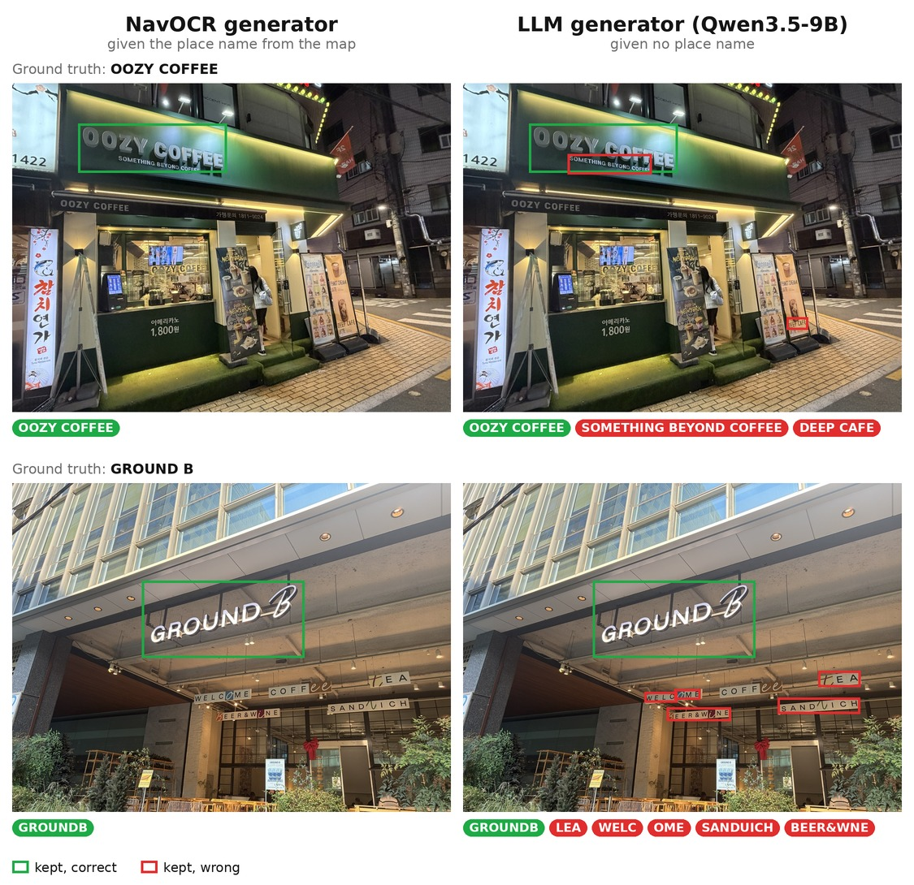
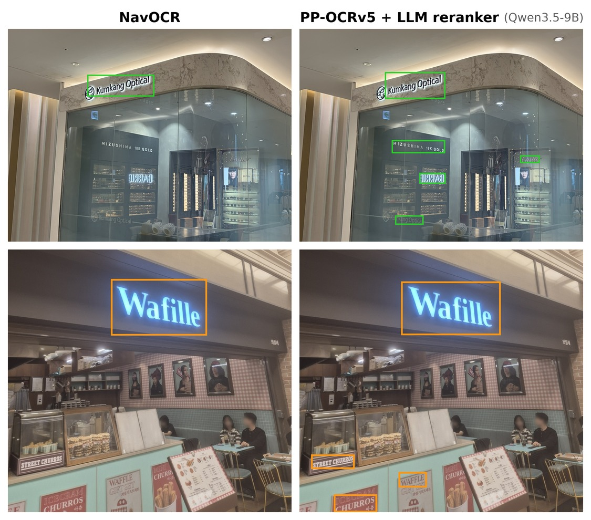

# OCR + LLM baselines for NavOCR

Code for the LLM rows in the [NavOCR](https://github.com/kc-ml2/NavOCR) paper.

NavOCR builds a training set for navigation-relevant text detection without
manual labelling. PP-OCRv5 reads the text in images of a place, and the
generator keeps the strings that match the place's name in open map resources,
such as OpenStreetMap. Compact detectors trained on this set then run on the
robot. A general-purpose LLM can also tell a shop name from an ad or a price, so
these experiments test whether an LLM could take over either step.

- **Table 1: can an LLM replace the map in the dataset generator?** The LLM
  generator gets the same OCR strings as the NavOCR generator, but no place
  name, and picks the place names itself. Both outputs are scored against text
  lists written by hand, so the gap shows what the map adds to label quality.
- **Table 3: can OCR plus an LLM replace the trained detector?** PP-OCRv5 finds
  every text box at inference time, and an LLM keeps the boxes whose text names
  a place. No detector is trained. AP against hand-drawn boxes and FPS are
  compared with the NavOCR-trained detectors. The target application, text
  mapping, needs about 10–15 FPS.

## Results

LLM rows show each model's best prompt.

### Table 1: dataset quality

Generator output against hand-written text lists, 304 images, micro average.

| Method | F1-score | Precision | Recall |
| --- | --- | --- | --- |
| NavOCR generator | 0.696 | 0.574 | 0.886 |
| Unfiltered OCR | 0.191 | 0.107 | 0.895 |
| LLM generator (Qwen3.5-9B, p3) | 0.420 | 0.289 | 0.772 |
| LLM generator (Qwen3.5-35B-A3B, p3) | 0.426 | 0.301 | 0.729 |



### Table 3: detection

AP against hand-drawn boxes, 1,554 images.

| Method | AP@0.25 | AP@0.50 | FPS |
| --- | --- | --- | --- |
| PP-YOLOE (NavOCR) | 0.827 | 0.711 | 111.1 |
| RT-DETRv2 (NavOCR) | – | – | 142.9 |
| PP-OCRv5 (NavOCR) | 0.463 | 0.344 | 68.0 |
| PP-OCRv5 + LLM reranker (Qwen3.5-0.8B, p1) | 0.199 | 0.162 | 8.4 |
| PP-OCRv5 + LLM reranker (Qwen3.5-2B, p1) | 0.224 | 0.183 | 8.1 |
| PP-OCRv5 + LLM reranker (Qwen3.5-4B, p6) | 0.226 | 0.183 | 5.3 |
| PP-OCRv5 + LLM reranker (Qwen3.5-9B, p3) | 0.266 | 0.220 | 5.2 |



## Setup

PaddlePaddle (OCR) and PyTorch (LLM) need different CUDA builds (11.8 and
12.6), so they cannot share one environment. Create two conda environments
(python 3.10). The OCR steps run in `navocr-ocr` and write a JSONL file; the
LLM and scoring steps run in `navocr-llm` and read it.

OCR and LLM run on an NVIDIA GPU. Qwen3.5-9B fits on a 24 GB GPU;
Qwen3.5-35B-A3B needs an 80 GB GPU.

```bash
cd NeurIPS2026

conda create -n navocr-ocr python=3.10 -y
conda activate navocr-ocr
pip install -e ".[ocr]" --extra-index-url https://www.paddlepaddle.org.cn/packages/stable/cu118/

conda create -n navocr-llm python=3.10 -y
conda activate navocr-llm
pip install -e ".[llm]" --extra-index-url https://download.pytorch.org/whl/cu126
```

Set `PYTHONNOUSERSITE=1` in both so packages from `~/.local` do not leak in.
Versions are pinned in [`pyproject.toml`](pyproject.toml). Table 1 was run with
`torch==2.14.1`, Table 3 with `torch==2.13.0`.

Models need no separate download. `filter` fetches the Qwen3.5 checkpoint from
Hugging Face on its first run, at the revision used in the paper
([`llm.py`](navocr_bench/llm.py)). PaddleOCR fetches its OCR models the same way.

Test sets: [ML2/navocr-testsets](https://huggingface.co/datasets/ML2/navocr-testsets)
on Hugging Face (CC BY-NC 4.0, faces blurred).

```bash
hf download ML2/navocr-testsets --repo-type dataset --local-dir data
```

## Reproduce Table 1 (dataset quality)

Can an LLM replace the map in the dataset generator? Text-list F1 of the
generator output on 304 images.

**Data.** `data/text_selection_benchmark`: 304 images. `text_string_label.txt`
has one line per image:

```
image name, {text on the sign}, {place name from the map}, {translation}
```

All rows are scored against the second field. The NavOCR generator matches OCR
strings against the third and fourth fields (similarity ≥ 0.5). The LLM never
sees them.

**Run.** [`run_dataset_quality.py`](run_dataset_quality.py)

```bash
# 1. OCR (conda activate navocr-ocr)
#    Reads every image with PP-OCRv5.
#    Output: out/dataset-quality/ocr_cache.jsonl (OCR strings per image)
python run_dataset_quality.py ocr --image-dir data/text_selection_benchmark/images \
    --gt-file data/text_selection_benchmark/text_string_label.txt --out-dir out/dataset-quality

# 2. LLM filter (conda activate navocr-llm)
#    The LLM picks the place names from each image's OCR strings.
#    One model load runs all six prompts.
#    Output: out/dataset-quality/sel.Qwen3.5-9B.p1.jsonl ... p6.jsonl
python run_dataset_quality.py filter --out-dir out/dataset-quality \
    --model Qwen/Qwen3.5-9B --prompts p1,p2,p3,p4,p5,p6 --batch-size 8

# 3. Score (navocr-llm)
#    Compares each selection with the hand-written labels.
#    Also scores the Unfiltered OCR row.
#    Output: out/dataset-quality/report.<model>.<prompt>.json (F1, precision, recall)
python run_dataset_quality.py score --out-dir out/dataset-quality \
    --gt-file data/text_selection_benchmark/text_string_label.txt

# 4. Table (navocr-llm)
#    Prints the Table 1 rows from the reports.
python run_dataset_quality.py table --out-dir out/dataset-quality
```

For Qwen3.5-35B-A3B, repeat step 2 with `--model Qwen/Qwen3.5-35B-A3B`, then
steps 3 and 4.

## Reproduce Table 3 (detection)

Can PP-OCRv5 plus an LLM replace the trained detector? AP and FPS on 1,554
images.

**Data.** `data/detection_benchmark`: 1,554 images, 1,695 hand-drawn boxes in
`instances_test.json` (COCO, one category).

**Run.** [`run_benchmark_detection.py`](run_benchmark_detection.py)

```bash
# 1. Manifest (conda activate navocr-ocr)
#    Fixes the image list and gives each image an id.
#    Output: out/detection/manifest.json
python run_benchmark_detection.py manifest --images data/detection_benchmark/images \
    --out out/detection/manifest.json

# 2. OCR (navocr-ocr)
#    PP-OCRv5 finds every text box and reads it.
#    Output: out/detection/ocr.jsonl (boxes, strings, confidences, OCR time per image)
python run_benchmark_detection.py ocr --manifest out/detection/manifest.json \
    --images data/detection_benchmark/images --out out/detection/ocr.jsonl

# 3. LLM filter (conda activate navocr-llm), once per model and prompt
#    The LLM keeps the strings that name a place.
#    Output: out/detection/Qwen3.5-9B.p3.jsonl (kept strings, LLM time per image)
python run_benchmark_detection.py filter --ocr out/detection/ocr.jsonl --model Qwen/Qwen3.5-9B \
    --prompt p3 --batch-size 8 --out out/detection/Qwen3.5-9B.p3.jsonl

# 4. AP (navocr-llm)
#    Keeps the boxes of the kept strings and scores them against the hand-drawn
#    boxes at IoU 0.25 and 0.50. Takes any number of filter outputs.
#    Output: out/detection/report.ap.json
python run_benchmark_detection.py ap --manifest out/detection/manifest.json \
    --gt data/detection_benchmark/instances_test.json \
    --ocr out/detection/ocr.jsonl --pred out/detection/Qwen3.5-*.jsonl \
    --out out/detection/report.ap.json

# 5. FPS (navocr-llm)
#    1 / (mean OCR time + mean LLM time).
#    Output: out/detection/fps.Qwen3.5-9B.p3.json
python run_benchmark_detection.py fps --manifest out/detection/manifest.json \
    --ocr out/detection/ocr.jsonl --filtered out/detection/Qwen3.5-9B.p3.jsonl \
    --out out/detection/fps.Qwen3.5-9B.p3.json
```

## Prompts

[`prompts.py`](navocr_bench/prompts.py) holds the six prompts (p1–p6).
`{items}` becomes the OCR strings as a JSON array.

## License

Code: [Apache License 2.0](../LICENSE), as in NavOCR. Data: CC BY-NC 4.0.
