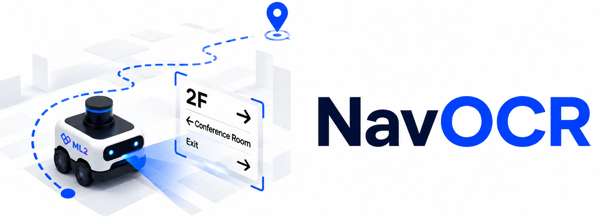

# NavOCR

<p align="center">
    
</p>
A lightweight, navigation-oriented OCR framework.

It is designed for robotic navigation scenarios, where only navigation-relevant text should be detected, such as:

- Signboards
- Room numbers
- Directional guides

while irrelevant text, such as advertisements or price tags, is ignored.  
If you'd like to see an example of SLAM using NavOCR, check it out our [TextMap examples](https://github.com/kc-ml2/TextMap_Examples).

📌 **Note:** This repository currently focuses on the NavOCR **inference model**. The NavOCR **dataset generator** for the **NeurIPS 2026** ED Track will be released together with the camera-ready manuscript. The update is coming soon.

## Key features

- Focuses on navigation-relevant text to reduce unnecessary information and improve OCR speed
- Supports both standalone and ROS 2 integration
- Optimized for CPU-first robotic platforms
- Supports PaddlePaddle for GPU environments
- Detects signboard text and directional guides


<p align="center">
    
</p>

<p align="center">
    
</p>


## Overview

- `navocr_standalone.py`: Run detection + OCR on a single image or a directory
- `navocr/ros_node.py`: ROS 2 node entry point
- `configs/navocr_onnx.params.yaml`: ONNX detector + ONNX OCR config (default)
- `configs/navocr_openvino.params.yaml`: OpenVINO detector + OpenVINO OCR config
- `configs/navocr_paddle.params.yaml`: PaddleDetection detector + Paddle OCR config
- `configs/navocr_pytorch.params.yaml`: PyTorch detector + PyTorch OCR config

## Backend Composition

| Model format | Runtime / engine | Hardware  | Text detection | Text recognition | FPS |
| ------------ | ---------------- | --------- | -------------- | ---------------- | --- |
| ONNX         | ONNX Runtime     | CPU / GPU | [PP-YOLOE](https://github.com/PaddlePaddle/PaddleDetection/blob/release/2.9/configs/ppyoloe/README.md) (Fine-tuned) | [PP-OCRv5](https://github.com/PaddlePaddle/PaddleOCR) | TBD |
| OpenVINO IR  | OpenVINO Runtime | Intel CPU | [PP-YOLOE](https://github.com/PaddlePaddle/PaddleDetection/blob/release/2.9/configs/ppyoloe/README.md) (Fine-tuned) | [PP-OCRv5](https://github.com/PaddlePaddle/PaddleOCR) | TBD |
| Paddle model | Paddle Inference | CPU / GPU | [PP-YOLOE](https://github.com/PaddlePaddle/PaddleDetection/blob/release/2.9/configs/ppyoloe/README.md) (Fine-tuned) | [PP-OCRv5](https://github.com/PaddlePaddle/PaddleOCR) | TBD |
| PyTorch      | PyTorch          | CPU / GPU | [PP-YOLOE](https://github.com/PaddlePaddle/PaddleDetection/blob/release/2.9/configs/ppyoloe/README.md) (Fine-tuned) | [PP-OCRv5](https://github.com/PaddlePaddle/PaddleOCR) | TBD |

*FPS benchmarks for the updated models are pending.*

## Installation

### Download Model
ONNX, OpenVINO, PaddlePaddle and PyTorch models are included in this repository.

```bash
git clone git@github.com:kc-ml2/NavOCR.git
```

### Python Environment Setup (recommended)

Using a `venv` keeps NavOCR's Python dependencies isolated from the system Python and avoids conflicts with `colcon build`.

```bash
python3 -m venv ~/.venvs/navocr
source ~/.venvs/navocr/bin/activate

pip install --upgrade pip
pip install colcon-common-extensions
```

### For ONNX runtime (default)

```bash
pip install onnxruntime pyyaml opencv-python numpy
```

If you want to run ONNX Runtime on CUDA, install `onnxruntime-gpu` instead of `onnxruntime`.

### For OpenVINO runtime (Optional)

```bash
pip install openvino pyyaml opencv-python numpy
```

### For PyTorch runtime (Optional)

```bash
pip install torch pyyaml opencv-python numpy
```


### For Paddle runtime (Optional)

This is only required for paddlepaddle backend.

> Tested with `paddlepaddle==3.0.0` and `paddleocr==3.4.0`.

Install PaddlePaddle following the official installation guide for your OS / Python / CUDA version:

- https://www.paddlepaddle.org.cn/en/install/quick

Then install PaddleDetection and PaddleOCR:

```bash
pip install pyyaml opencv-python numpy

# PaddleDetection
git clone https://github.com/PaddlePaddle/PaddleDetection.git

cd PaddleDetection
pip install -r requirements.txt
python setup.py install

# PaddleOCR
pip install paddleocr
```

## Standalone Inference

### Download Testset

```bash
# Setup python env
pip install gdown==5.2.0

# Download sample testset
mkdir data && cd data
gdown https://drive.google.com/uc?id=1GcgddRm4GsjPKUOVdmWFzeF5gElCZfx2
unzip example_sequence.zip 
cd .. && mkdir results
```

### Run with ONNX runtime (default)
```bash
python navocr_standalone.py \
  --params-file configs/navocr_onnx.params.yaml \
  --infer_dir data/example_sequence/images
```

### Run with OpenVINO runtime
```bash
python navocr_standalone.py \
  --params-file configs/navocr_openvino.params.yaml \
  --infer_dir data/example_sequence/images
```

### Run with PyTorch runtime
```bash
python navocr_standalone.py \
  --params-file configs/navocr_pytorch.params.yaml \
  --infer_dir data/example_sequence/images
```

### Run with Paddle runtime
```bash
python navocr_standalone.py \
  --params-file configs/navocr_paddle.params.yaml \
  --infer_dir data/example_sequence/images
```

### Single image
```bash
python navocr_standalone.py \
  --params-file configs/navocr_onnx.params.yaml \
  --input data/example_sequence/images/000000.jpg
```


## ROS 2 Node

### Build ROS 2 package

ROS dependencies are declared in `package.xml`. Install them from the workspace root with:

```bash
cd ~/ros2_ws  # your ros2 workspace
rosdep install --from-paths src --ignore-src -r -y

colcon build --symlink-install --packages-select navocr
python -m colcon build --symlink-install --packages-select navocr  # if you're using venv

source install/setup.bash
```

### Run ros2 node

```bash
ros2 run navocr navocr_with_ocr_node
```

The default ROS 2 params file is `configs/navocr_onnx.params.yaml`.

If you want to select a different params file at runtime:
```bash
ros2 run navocr navocr_with_ocr_node --ros-args \
  -p params_file:=/absolute/path/to/configs/navocr_pytorch.params.yaml

ros2 run navocr navocr_with_ocr_node --ros-args \
  -p params_file:=/absolute/path/to/configs/navocr_openvino.params.yaml

ros2 run navocr navocr_with_ocr_node --ros-args \
  -p params_file:=/absolute/path/to/configs/navocr_paddle.params.yaml
```

Published topics:

- `detections_topic` default: `/navocr/detections`
- `annotated_image_topic` default: `/navocr/annotated_image`

The ROS 2 node publishes OCR text for signboards and labels directional guides as `directional_guide` without running OCR on them.

## Acknowledgements

We gratefully acknowledge the open-source projects that made this work possible:
[PaddleDetection](https://github.com/PaddlePaddle/PaddleDetection),
[PaddleOCR / PP-OCRv5](https://github.com/PaddlePaddle/PaddleOCR),
[OpenVINO](https://github.com/openvinotoolkit/openvino), and
[ONNX](https://github.com/onnx/onnx).


## 🚧 Planned Updates
We're working on expanding support beyond store signboards detection model.
Stay tuned for upcoming features for broader navigation use cases.

- [x] Library migration due to a license issue (`ultralytics` -> `PaddleDetection`)
- [x] Alternative inference for higher FPS on CPU (Add `OpenVINO` support)
- [x] Integration with text recognition (PaddleOCR)
- [x] Integration with SLAM packages via ROS (TextMap)
- [x] Directional guide detection
- [ ] Model training scripts (Dataset crawling, model fine-tuning, ...)
- [ ] Floor sign detection


## License
This repository is licensed under the Apache License, Version 2.0.

This project includes code and configuration files derived from
PaddleDetection (https://github.com/PaddlePaddle/PaddleDetection), 
which are also licensed under the Apache License, Version 2.0.
